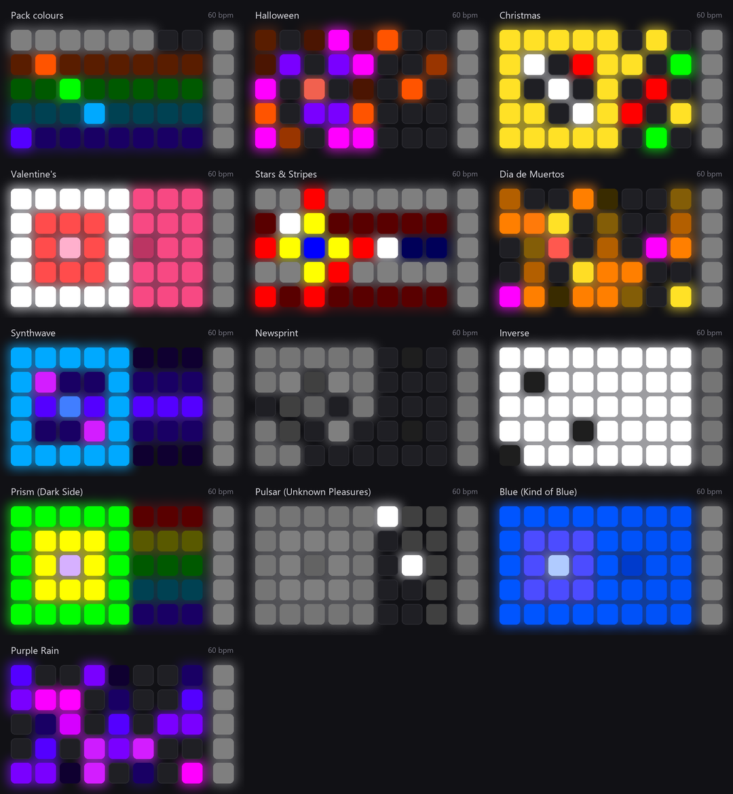
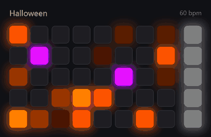
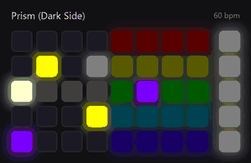
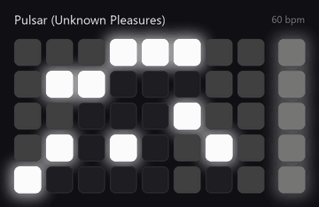
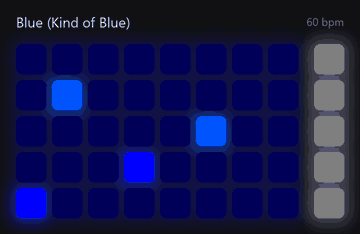
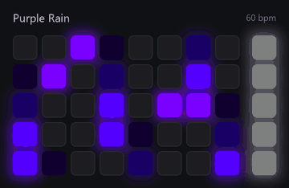
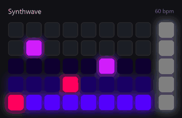
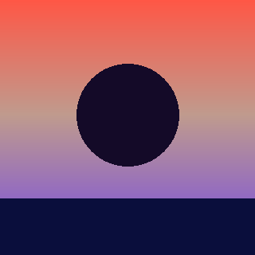
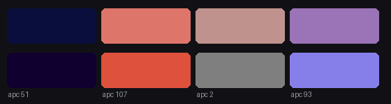

# APC40 mkII Colour Lab

A proof of concept for making the APC40 mkII's MIDI do more than Resolume's own feedback does.

**Open [`apc40_colour_lab.html`](apc40_colour_lab.html)** (one file, no network). It is an emulated APC40 mkII beside the raw colours Resolume would send, thirteen
themes, a live MIDI monitor and a tempo slider. Click the pads, or load a theme you made from a picture.

<p align="center"></p>

*The thirteen themes a moment after a pad press. These and the clips below are the **emulated** pads, rendered by [`tools/render_clips.py`](tools/render_clips.py) from the same
engine that would drive the controller. They are not photographs of a real APC40.*

## Highlights

Each loop is ten seconds at 60 bpm: ambient animation on the dark pads, two pad presses, then a Scene Launch press.

| | |
|---|---|
| **Halloween**: candle-flicker on the empty pads, playing pads breathe pumpkin to violet, a violet ripple on every press<br> | **Prism (Dark Side)**: a white beam, a prism, a five-row spectrum, one pulse of light travels the whole way<br> |
| **Pulsar (Unknown Pleasures)**: stacked white lines with lumps that rise out of the middle and are redrawn slowly<br> | **Blue (Kind of Blue)**: one colour; every empty pad breathes between two blues<br> |
| **Purple Rain**: violet and magenta fall slowly through the empty pads<br> | **Synthwave**: a slow scan line over azure and violet, pink shockwave on a press<br> |

The other seven (Christmas, Valentine's, Stars & Stripes, Dia de Muertos, Newsprint, Inverse and the Pack baseline) are in [`docs/media/`](docs/media) as `<theme>.gif`.

## The idea

On the RGB pads (the 40 clip pads, notes 0-39, and the 5 Scene Launch pads, notes 82-86) the note-on **velocity picks the colour** from a fixed
128-entry palette and the note-on **channel picks an animation** that the controller then runs by itself:

| MIDI channel | Animation | Rates (MIDI clock ticks, 24 per quarter note) |
|---|---|---|
| 1 | primary colour, static | |
| 2-6 | one-shot to a secondary colour | 1/24 · 1/16 · 1/8 · 1/4 · 1/2 (4 · 6 · 12 · 24 · 48 ticks) |
| 7-11 | pulsing between primary and secondary | same |
| 12-16 | blinking between primary and secondary | same |

So two messages per pad make it breathe or blink with no further traffic. Resolume's MIDI shortcut feedback can only send one velocity per state; a **router
on the LED path** can do much more:

* **Re-theme any pack** without rebuilding its preset: green playing / dim green loaded becomes pumpkin and violet, red and green, or pure greys.
* **Fill the dark pads** with an ambient show (flicker, marquee chase, falling petals, a scan line, a prism, stacked pulsar lines) that Resolume knows nothing about.
* **Answer every press** with a ripple, a cross, a sparkle or a full-grid inversion, as one-shot messages timed by the controller.
* **Host the rings** as meters: 16 LED rings, ring style set once, value only when it changes.
* **Be the MIDI clock** the animations need.

## Themes

| Key | Name | What it does |
|---|---|---|
| `pack` | Pack colours | Resolume's own feedback, untouched: the baseline |
| `halloween` | Halloween | pumpkin, violet, slime; candle flicker; violet ripple |
| `christmas` | Christmas | red, green, gold; slow marquee chase; gold star |
| `valentine` | Valentine's | rose, red, white; heartbeat on loaded pads |
| `stars` | Stars & Stripes | red, white, blue stripes; firework cross |
| `muertos` | Dia de Muertos | marigold, magenta, turquoise; falling petals; sparks |
| `synthwave` | Synthwave | hot pink, violet, azure; scan line; shockwave |
| `newsprint` | Newsprint | black and white only: colour becomes brightness |
| `inverse` | Inverse | black and white as a negative; a press flips the grid |
| `darkside` | Prism (Dark Side) | after the sleeve of *The Dark Side of the Moon* (1973): beam, prism, spectrum |
| `pulsar` | Pulsar (Unknown Pleasures) | after the sleeve of *Unknown Pleasures* (1979): stacked lines with lumps |
| `kindofblue` | Blue (Kind of Blue) | after *Kind of Blue* (1959): one colour, two blues |
| `purplerain` | Purple Rain | after *Purple Rain* (1984): one colour, falling |

They are plain data in [`apc_lab/themes.json`](apc_lab/themes.json): velocities from the real palette, plus a remap rule, an ambient animation and a touch effect. The four record-sleeve
themes are *inspired by* the sleeves' best-known idea (a prism, a plotted pulsar, a single colour); they do not reproduce any artwork.

### Slow on purpose

The first look at real hardware (2026-10-23) found the animation rates "a bit too fast". Everything now defaults to **60 bpm** (`protocol.DEFAULT_BPM`): a beat is a second, so the
slowest animation the controller offers (1/2, two beats) is a two-second breath. Held animations (playing pulse, blink, ambient pulse) use 1/2 and never anything faster than 1/4;
one-shot ripples use 1/8 at the fastest. `python -m apc_lab.live --bpm 45` slows it further; the demo's slider goes down to 40.

## Make a theme from a picture

[`tools/theme_from_image.py`](tools/theme_from_image.py) takes any image (an album sleeve, a poster, a photo) and builds a theme from it: it finds the picture's dominant colours with
median cut, maps each to the **nearest of the APC's 128 LED colours** in CIELAB, and uses them as the colour families, the playing-pad pulse, the ambient animation and the press ripple.
The same picture always gives the same theme.

```
python tools/theme_from_image.py cover.jpg --out cover.json --preview cover_colours.png
python tools/theme_from_image.py cover.jpg --ambient rain         # pulse | rain | scan | flicker | chase
python -m apc_lab.live --dry-run --theme-file cover.json --theme cover
```

Or open the demo and use **Load theme (.json)**. `python tools/theme_from_image.py --demo` makes the procedural sleeve below (no copyright involved) and its theme:

<p> </p>

The strip is the point of the tool: top row, what the picture has; bottom row, what 128 LEDs can show of it. A cream becomes the nearest warm grey or yellow, a deep navy becomes a very dark violet.

## What is verified, and what is not

| | |
|---|---|
| Message encoding, channel/animation table, palette, SysEx bytes | 58 unit tests, checked against Akai's protocol v1.2 and Ableton's own APC40 mkII skin |
| Python engine = JavaScript engine | `tools/parity.py`: 117 scenarios (13 themes, full and dark grids), 70,884 messages, 0 differences |
| The demo page | loaded and clicked in a browser; all 13 cards build, the theme loader accepts a made theme and rejects bad ones. The four sleeve themes were checked through the rendered frames above and the tests, not by clicking each |
| The clips and stills in this README | rendered from the engine; they show the messages, not a controller |
| **The animations on real hardware** | **partly confirmed by eye, 2026-10-23.** `tools/hardware_test.py` drove a real APC40 mkII while Avenue was running: the palette lit, the pads pulsed ("amazing"), and the rates were "a bit too fast" (hence the 60 bpm default). The performer's live comments did not cover the tempo, blink, one-shot, cancel and scene-pad stages one by one, so those are still open. The slowed rates and the four sleeve themes have **not** been seen on the controller. A second process can open the controller's output port alongside Avenue (Windows shares it); no mode SysEx was sent and the rings were not tried |

Still open after the first hardware look (the Akai document does not say; `tools/hardware_test.py --only pulse60,pulse120,oneshot,cancel,scene` asks exactly these):

1. Do the pads follow a host MIDI clock (`0xF8`, 24 per quarter note), and what tempo do they use without one? Push 2's equivalent documentation says 120 bpm. (If they ignore the clock, the 60 bpm default changes nothing on the controller and only the software rates in the themes slow down.)
2. Which way a one-shot runs (secondary then back to primary, as emulated here), and whether a note on channel 1 always cancels an animation.
3. Whether the Scene Launch pads animate like the clip pads.

`python -m apc_lab.live --dry-run` prints the exact bytes the router would send without opening a port; `--list` names the ports.

## Running it

```
python -m pytest tests                 # 58 tests
python tools/parity.py                 # Python engine vs demo/engine.js (needs node)
python tools/build_demo.py             # rebuild apc40_colour_lab.html
python tools/render_clips.py           # re-render docs/media (needs Pillow)
python -m apc_lab.live --dry-run --theme halloween
```

## On the rig

The router must sit on the LED path, so it has to own the controller's ports (or share them).

```
 APC40 mkII --presses--> router --forwarded--> [virtual "to-res"]   --> Resolume MIDI in
 APC40 mkII <--LEDs----- router <--feedback--- [virtual "from-res"] <-- Resolume MIDI out
```

* **Mode 2.** The controller wakes in Mode 0 after every power cycle. Send `F0 47 7F 29 60 00 04 42 00 00 00 F7` so the host owns every LED, rings included. The repo's
  current presets assume Mode 1; the router and the preset must agree on a single owner of the LEDs.
* **Virtual ports.** loopMIDI is not installed on this rig. Windows MIDI Services (`midisrv`) is running on build 26200 and may allow a second client on the APC itself;
  that is untested. See [`docs/CHATAIGNE.md`](docs/CHATAIGNE.md) for hosting this in Chataigne, which is installed here (1.10.3).

## Findings along the way

* `resolume_build/apc.py` names its LED velocities a hue family off the real LEDs (velocity 37 is azure, 45 is blue, 49 violet, 53 magenta, 57 rose). The velocities are
  right and the packs are unaffected; only the colour *names* are misleading.
* Reading the community Chataigne APC40 module's source, it appears to pass its pad "mode" enum (0-15) straight to `sendNoteOn` as a Chataigne channel (1-16), which would put every
  animation one channel early on the wire. Untested. Hosting this lab in Chataigne should use its plain MIDI module, not that enum.
* The one-shot flash lasts a whole note value, so at a slow tempo a ripple only reads as a ring if the step between rings is about half the flash. At 60 bpm a 1/8 flash is 0.5 s and the ripple steps 0.25 s.

## Credits and licence

Palette: Akai APC40 Mk2 Communications Protocol v1.2, cross-checked against Ableton's `RGB_COLOR_TABLE` and
[cunabula27's APC40-MkII-Chataigne-Module](https://github.com/cunabula27/APC40-MkII-Chataigne-Module) (GPL-3.0, not included here). Code: the repository's licence.
Album titles are named only to say what a theme is inspired by; no artwork is included.
