# Gallery

Every composition in this kit, opened on Resolume Avenue 7.28.1 and photographed from its own Composition Monitor.
Each card shows the most interesting of the frames sampled (up to 6 decks x 4 columns), the part of Avenue's
clip grid it uses, and where it lives. To show each composition whole, layers were taken off the crossfader and
solo/bypass cleared for the photographs (live state only, nothing saved); dashboard knobs are as saved.
Regenerate with `python -m resolume_build.gallery` from the build repo.

## APC40 Visual QA 148

The stable release: every physical control of the APC40 mkII mirrored on screen by 148 native Text Animator witnesses.  [`compositions/`](../compositions)

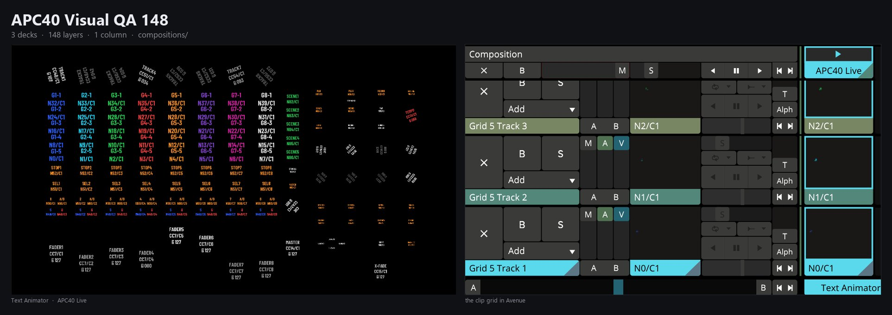

## Electric Zentropa

The performance interface, built only from native Resolume sources (Lost Buttons edition; True Button Toggles shares the interface).  [`compositions/`](../compositions)

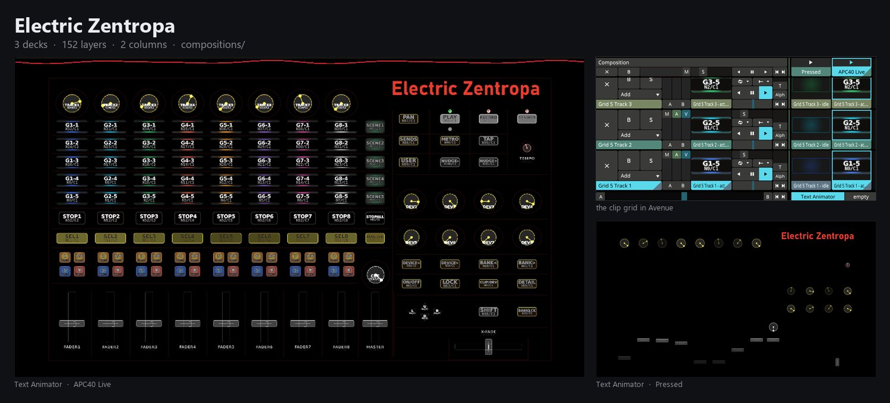

## Res React Live Gen

An audio-reactive generative instrument: FFT-driven stock generators across six decks.  [`beta/compositions/`](../beta/compositions)

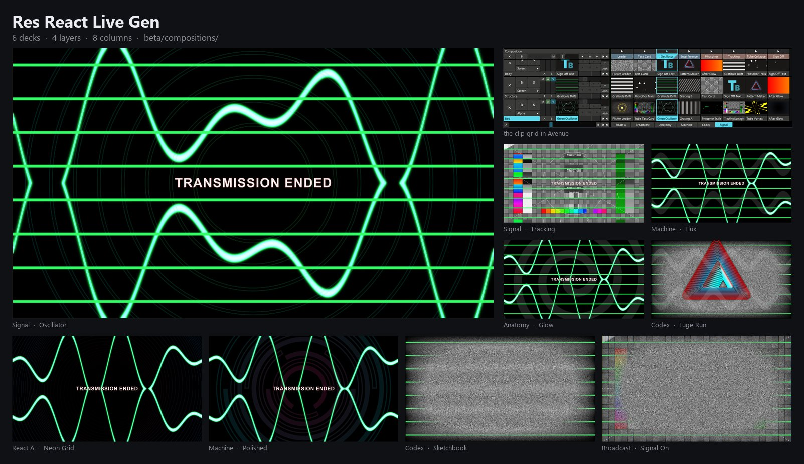

## Res React Orbit Gen

Orbit: five FFT-reactive decks specified cell by cell in the manifests.  [`beta/compositions/`](../beta/compositions)

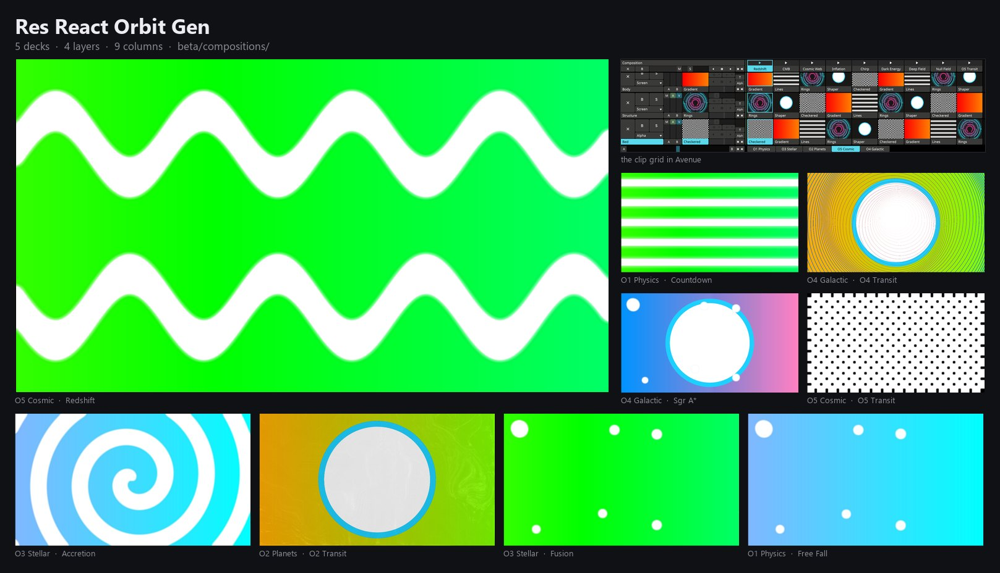

## Res React Lexicon

The controller as a sentence machine: five pad rows are the five slots of a sentence, 512 grammatical sentences.  [`beta/lexicon/`](../beta/lexicon)

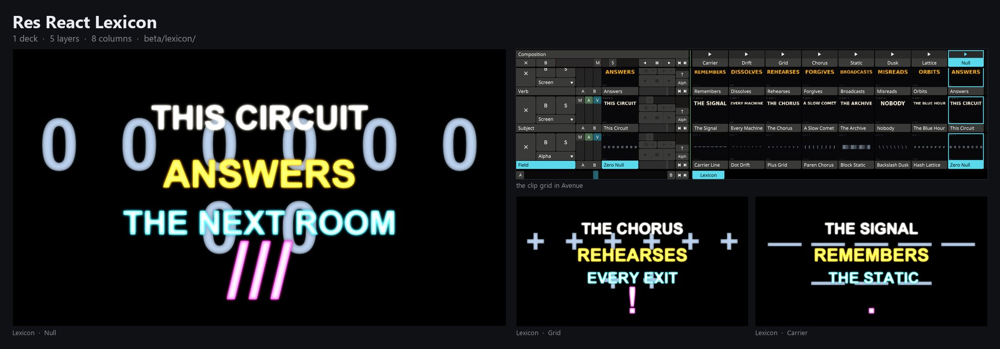

## Res React Lexicon II - Eighties-ism

The sequel: 200 pads of found broadcast-age text across five decks.  [`beta/lexicon-ii/`](../beta/lexicon-ii)

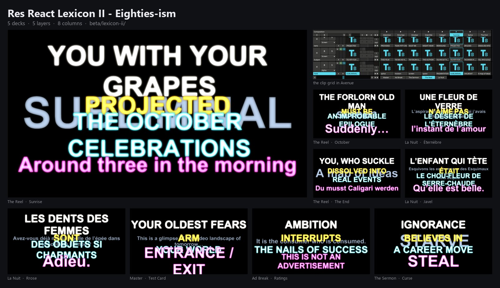

## Res React Test Card

Pure signal: every pad a typographic test pattern, all of them moving under live WaveWarp.  [`beta/testcard/`](../beta/testcard)

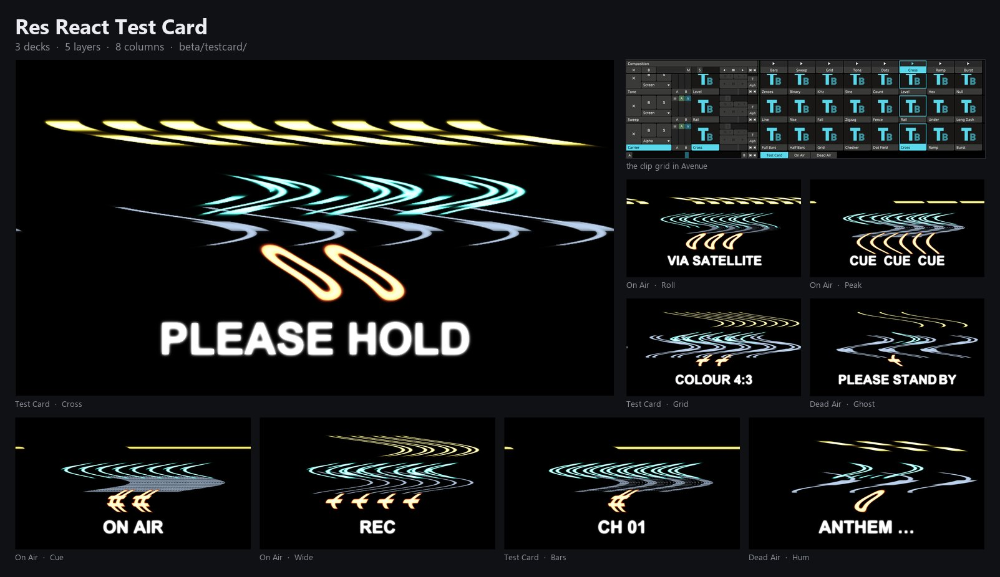

## Res React Nisei

Archival testimony, poetry, documents and places from the Japanese American experience, for Nisei Week.  [`beta/nisei/`](../beta/nisei)

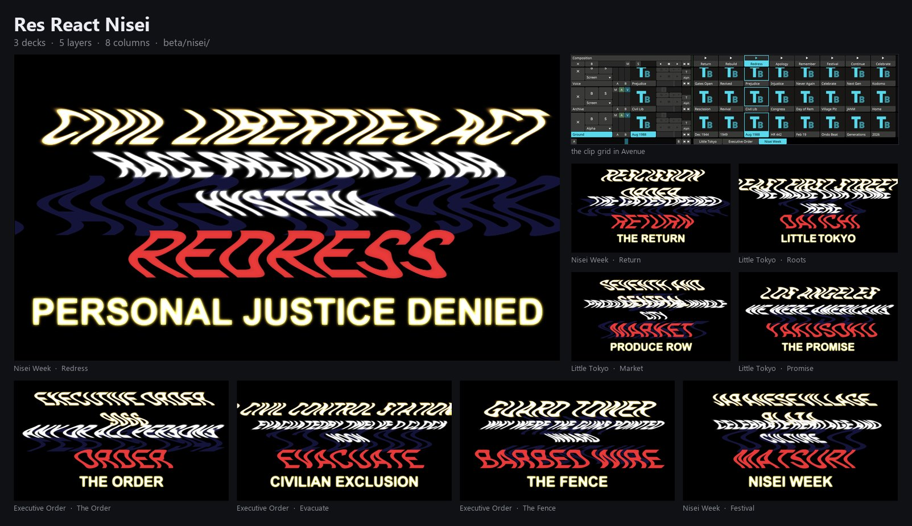

## EarthSearch EP01 Live Mix

Not a clip launcher: two 27-minute masters that never stop, and a surface that shapes them.  [`beta/earthsearch/`](../beta/earthsearch)

*No frame captured: its two 27-minute video masters live outside the repo and were not on this machine, so Avenue showed black.*

## Dead Air - Listening Posts

Five rooms where someone is listening to the dark, and the dark, occasionally, replies.  [`beta/dead-air/`](../beta/dead-air)

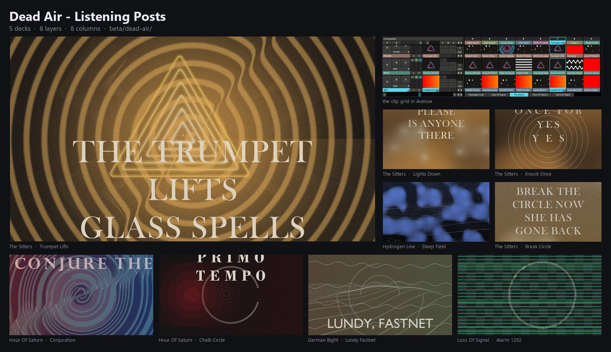

## Dew Line - The Spinningwork

A spider builds an early-warning station out of silk and casts her shadow on every star the net catches.  [`beta/dew-line/`](../beta/dew-line)

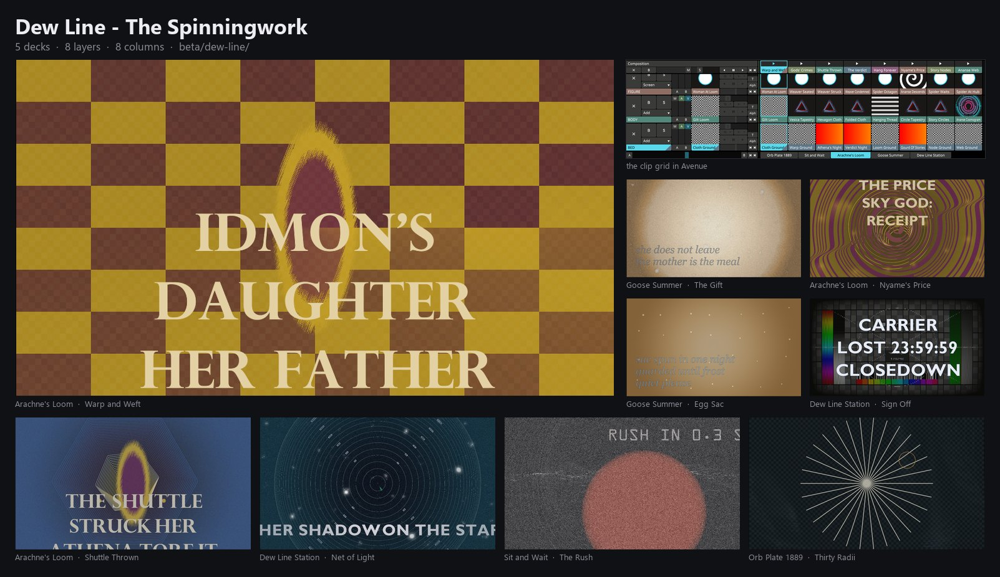

## The Library And The Hand - GUSTO

GUSTO, a proposed robot that fetches, flips, mixes and scratches real vinyl; stylus-cyan is documented, cue-orange proposed.  [`beta/library-hand/`](../beta/library-hand)

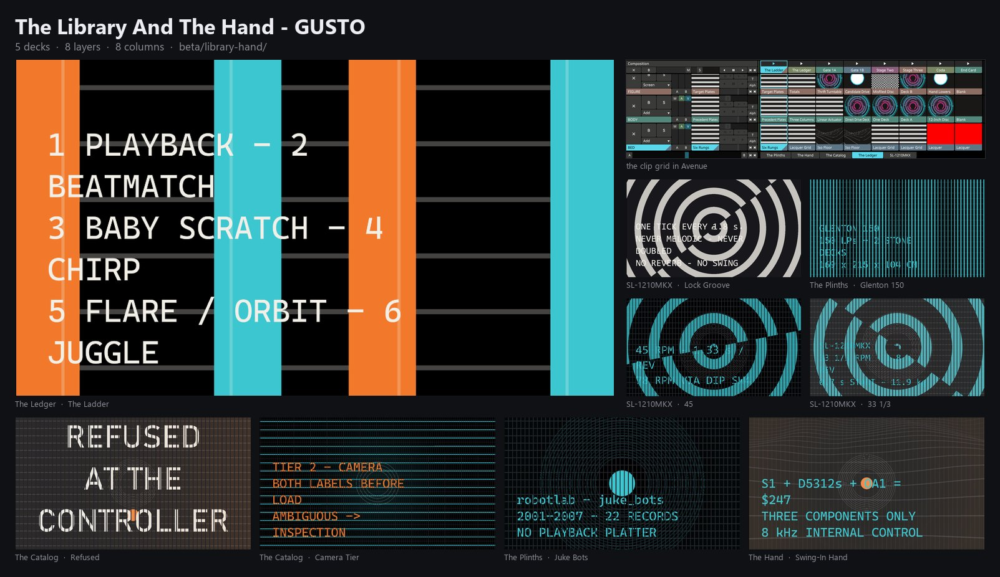

## Studio One - War Of The Worlds 1938

For the broadcast's 88th anniversary: CBS Studio One, Grovers Mill, the Visitors, New York, the Morning After.  [`beta/studio-one/`](../beta/studio-one)

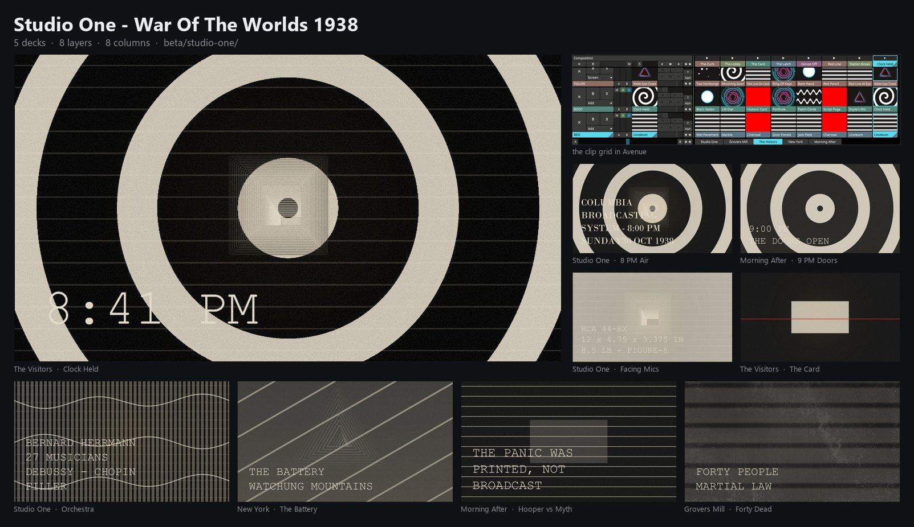

## Signal Lost - Transmission From Tomorrow

The OldTimeRadio pipeline as a show, including a VJ journey through the workflow one node per scene.  [`beta/signal-lost/`](../beta/signal-lost)

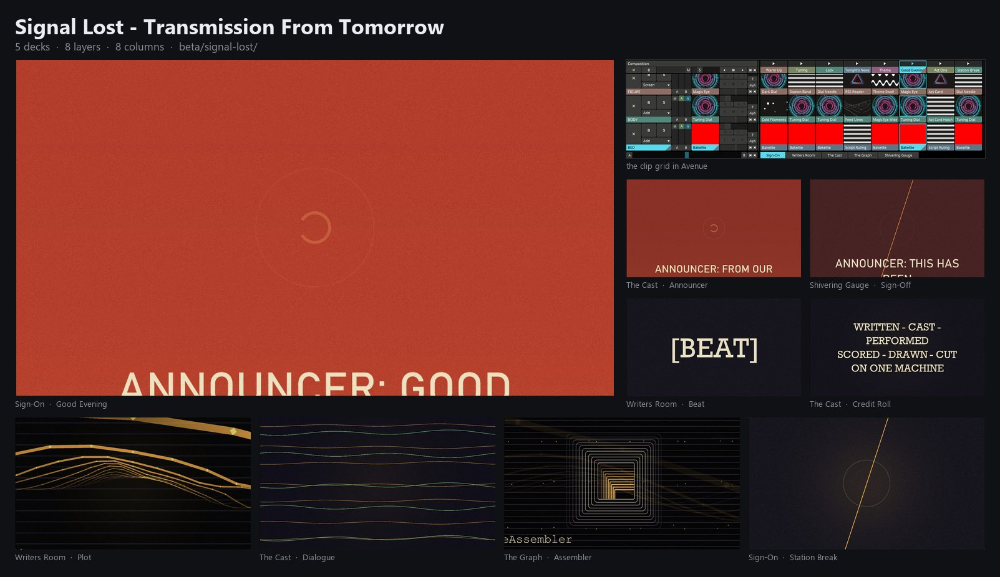

## The Manual - Avenue 7.28.1

A composition about Resolume itself: the vocabulary, the clip, parameter animation, the 62 blend modes, this rig.  [`beta/the-manual/`](../beta/the-manual)

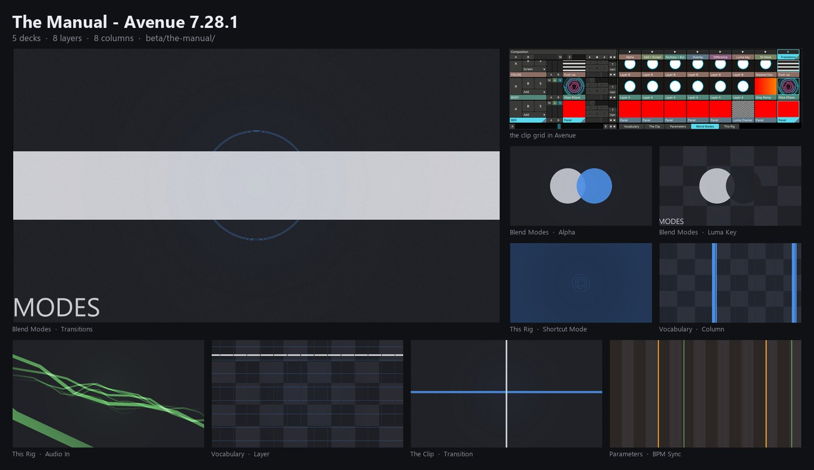

## The Surface - APC40 mkII + MIDI

The controller every pack here is played on, drawn as schematics, every number from Akai's protocol document.  [`beta/the-surface/`](../beta/the-surface)

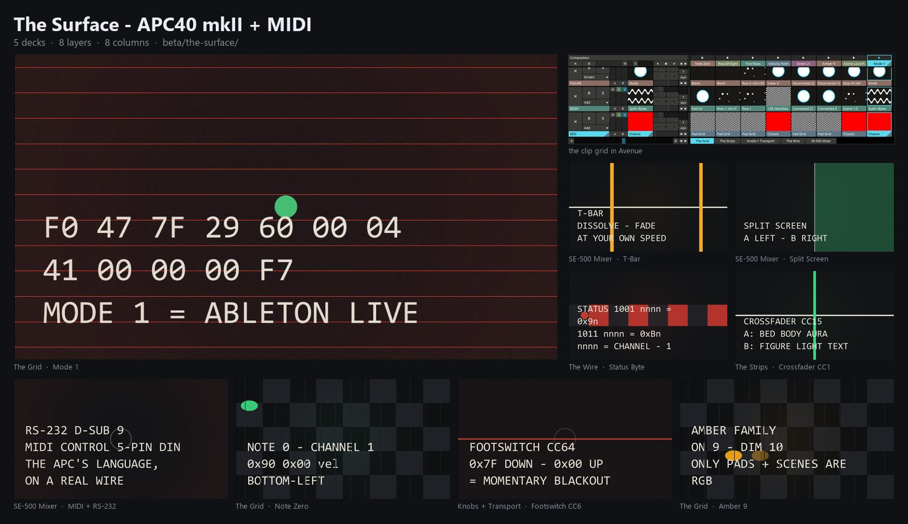

## The Mixers - V-4, MXPro, MX-1 + JVC

Three video mixers (Edirol V-4, Videonics MXPro, MX-1), a JVC S-VHS deck beside a pro edit controller, and the APC40 itself; LEFT and RIGHT walk the six decks.  [`beta/the-mixers/`](../beta/the-mixers)

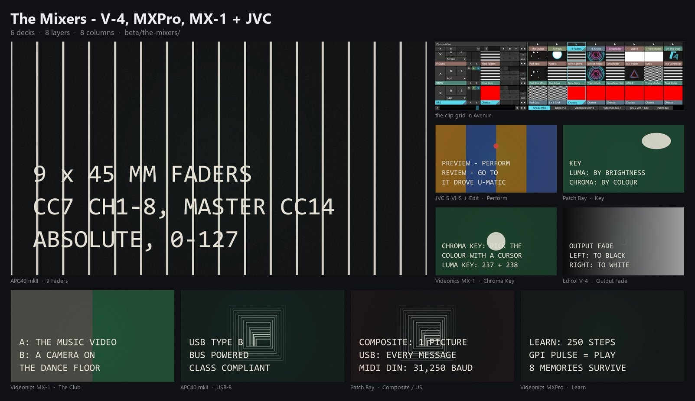
